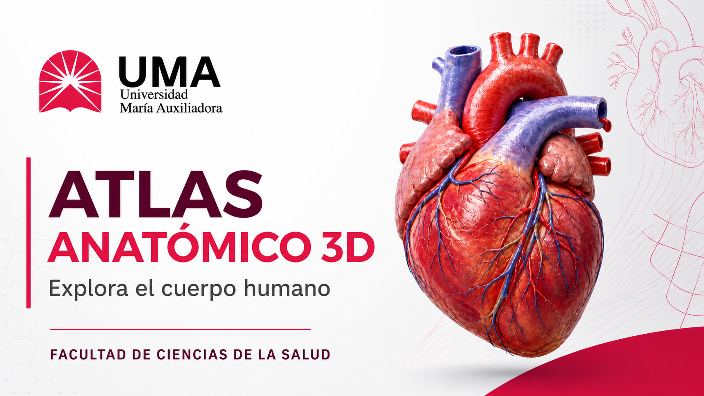

<div align="center">

# UMA · Atlas Anatómico 3D

**Explore human anatomy. Understand movement. Connect structure with function.**

An interactive learning platform for the students of **Universidad María Auxiliadora**, Lima, Peru.




[Overview](#overview) · [Learning modules](#learning-modules) · [Getting started](#getting-started) · [Deployment](#deployment) · [Credits](#credits-and-usage)

</div>

## Overview

UMA Atlas Anatómico 3D brings interactive organ models, whole-body exploration, anatomical movement, dental anatomy, and echocardiography practice into one browser-based environment. It is designed to support free, publicly accessible anatomy education for the UMA community, with a Spanish interface and the university's visual identity.

Students can examine structures from different angles, explore their relationships, review guided lessons, and check their understanding through quizzes. Reference material, favorites, and saved progress help them return to a topic and continue studying at their own pace.

| Organ models | Anatomical movements | Learning environment |
| :---: | :---: | :---: |
| **9** interactive organs | **58** animations | **Spanish** interface |

## Learning modules

| Module | Learning experience |
| --- | --- |
| **Explorar** | Inspect 3D organs with rotation, zoom, anatomical points of interest, illustrations, and supporting explanations. |
| **Exploración** | Explore whole-body anatomy through systems, male and female configurations, structure selection, isolation, opacity, and section controls. |
| **Movimientos** | Study anatomical movement with searchable animations, regional filters, playback controls, speed adjustment, and a timeline. |
| **Odontología** | Examine teeth, internal dental anatomy, layers, and sections through an integrated 3D dental viewer. |
| **Ecocardiografía** | Practice with an echocardiography simulator, educational guidance, clinical video examples, and reference calculators. |
| **Lecciones** | Work through organ-focused learning material and quizzes, with lesson completion and saved scores. |
| **Biblioteca** | Find anatomy books, articles, and organ-specific reference resources. |

The organ collection includes the **heart, brain, lungs, liver, kidneys, eye, intestine, pancreas, and skin**.

### Built for independent study

- **Find a structure quickly** with global search and organ filters.
- **Resume a study session** using recently viewed organs and the last explored model.
- **Keep useful topics close** with favorites and a personal progress view.
- **Learn across screen sizes** with desktop and mobile navigation, plus touch interaction in the viewers.

Study progress, quiz scores, favorites, settings, and notes are stored locally in the browser. The current application does not require an account or a configured database; local study data does not synchronize between devices and can be removed by clearing browser storage.

## Technology

| Layer | Technologies |
| --- | --- |
| Application | React 19, TypeScript, Next.js 16 / Vinext |
| 3D visualization | Three.js, WebGL, GLB models, geometry and texture decoders |
| Interface | Tailwind CSS 4, GSAP, Lucide icons |
| Student data | Browser `localStorage` |
| Production targets | Next.js on Vercel; Vinext production build |

The specialized viewers and their assets are hosted with the application. Optional Cloudflare D1/Drizzle scaffolding is included for future server-side features; it is not required for the current learning experience.

## Getting started

### Requirements

- **Node.js 24.x** and npm.
- A modern browser with **WebGL** enabled.
- The complete repository, including `public/` and `vendor/dental-scope/`.

### Run locally

```bash
git clone https://github.com/darshanbachhav0/anatomy.git
cd anatomy
npm ci
npm run dev -- --port 3001
```

Open **http://localhost:3001** in your browser.

The development command automatically builds the dental module and prepares third-party notices. Install dependencies from the repository root so npm also installs the dental workspace.

## Deployment

### Vercel

The repository includes a [Vercel configuration](vercel.json) for the Next.js build:

| Setting | Value |
| --- | --- |
| Framework preset | Next.js |
| Install command | `npm ci` |
| Build command | `npm run build:next` |
| Node.js | `24.x` |

Set `NEXT_PUBLIC_SITE_URL` to the final HTTPS address before building so social previews and absolute metadata URLs use the correct domain. Attach the UMA subdomain through the hosting project's domain settings and coordinate its DNS entry with the university's IT team.

To verify this build locally:

```bash
npm run build:next
npx next start
```

### Vinext

For the Vinext production target:

```bash
npm run build
npm start
```

Use the matching build and start commands for each target. For the current Vinext version, use Linux for production: its Windows production server has a documented nested-asset path issue. Local development on Windows uses the development command above.

<details>
<summary><strong>Asset packaging and build integrity</strong></summary>

- Keep the complete models, textures, videos, atlas data, and decoder files in the deployment. The repository contains more than 1 GB of public assets; check your hosting plan's file, storage, and transfer limits.
- Preserve `.glb.part000`, `.glb.part001`, and subsequent model parts exactly. The atlas needs every part to reconstruct its larger models.
- `public/dental/` is generated during development and production builds. Its source is maintained in `vendor/dental-scope/`.
- Commit `.gitattributes` alongside license files and decoders. It preserves the original bytes of checksum-verified assets across Windows and Linux checkouts, including the CRLF line endings in the DM Sans license.
- Notice generation runs offline during the build. Keep its integrity checks enabled; upstream license synchronization is a separate maintenance task.

</details>

## Development and verification

| Command | Purpose |
| --- | --- |
| `npm run lint` | Check application and supporting code with ESLint. |
| `npx tsc --noEmit` | Check TypeScript types. |
| `npm test` | Build the Vinext target and run the main verification suites. |
| `npm run test:atlas` | Verify the body-atlas integration. |
| `npm run test:study-atlas` | Verify exploration scenes, movement data, and model assets. |
| `npm run test:dental` | Run the dental workspace tests. |
| `npm run test:echo` | Verify the echocardiography integration and Spanish guidance. |
| `npm run test:compliance` | Verify notice coverage, attribution access, and preserved upstream bytes. |
| `npm run licenses:check` | Check that generated third-party notices are current. |
| `npm run check:spanish` | Check the body-atlas Spanish translation data. |

### Repository guide

```text
app/
  components/           Application interface and learning modules
  hooks/                Student data and application hooks
  lib/                  Anatomy content, storage, search, and 3D utilities
public/
  anatomy/              Organ illustrations and thumbnails
  atlas/                Body-atlas geometry and data
  models/               Organ models and textures
  study-atlas/          Whole-body exploration and movement viewer
  echo/                 Echocardiography viewer and learning assets
  third-party-notices/  Generated dependency notices and inventory
vendor/dental-scope/    Integrated dental viewer source
docs/                   Module integration documentation
scripts/                Build, translation, asset, and notice tooling
tests/                  Application and integration verification
compliance/             Provenance and rights evidence records
```

## Credits and usage

This platform brings together original application work and third-party software, anatomical resources, and educational media. Acknowledgements and licenses remain available in the application and in the repository:

- [Body atlas: sources and attribution](public/atlas/ATRIBUCION.md)
- [Dental Scope: credits](vendor/dental-scope/CREDITS.md) and [UMA integration](vendor/dental-scope/UMA-INTEGRATION.md)
- [Echocardiography: provenance and adaptation](public/echo/ADAPTACION-UMA.md)
- [Third-party software notices](public/third-party-notices/THIRD_PARTY_NOTICES.txt)
- [Copyright information](COPYRIGHT.md) and [rights evidence register](compliance/rights-register.json)

Individual components retain their respective terms. Free educational access does not grant a blanket license to redistribute this repository or its assets. Some rights records remain unverified; review the recorded permissions and applicable conditions before public redistribution. `npm run copyright:status` displays the outstanding records, and `npm run check:copyright:release` checks their verification status.

**Educational use:** The platform supports anatomy teaching and independent study. It does not replace clinical training, professional judgment, or medical advice. Educational content, translations, and calculator outputs should receive appropriate faculty review.

---

<div align="center">

**Universidad María Auxiliadora · Lima, Perú**<br>
Facultad de Ciencias de la Salud

</div>
